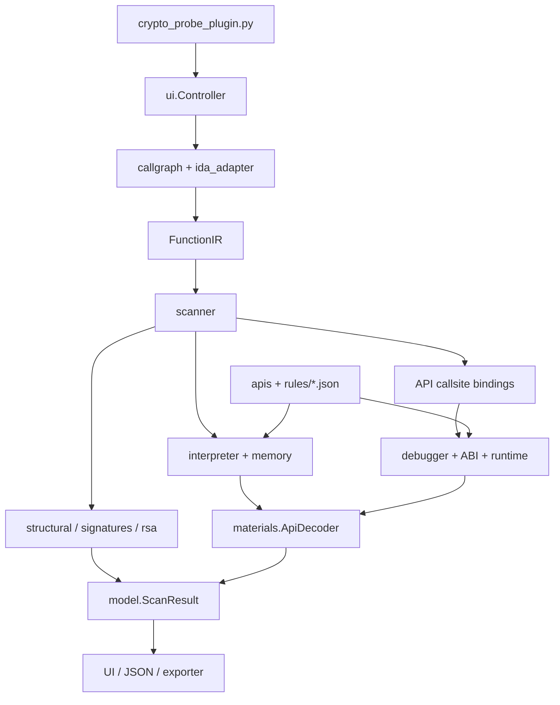

# Kiến trúc và luồng phân tích

Crypto Probe gồm một lớp truy cập IDA và một lõi phân tích viết bằng Python. Static analysis và debugger capture cùng sử dụng API profiles, bộ giải nghĩa tham số và định dạng kết quả, nhưng lấy dữ liệu từ hai nguồn khác nhau.

## 1. Thuật ngữ

| Thuật ngữ | Nghĩa trong project |
|---|---|
| API | Hàm có giao diện đã biết, ví dụ `EVP_EncryptInit_ex` của OpenSSL hoặc `BCryptEncrypt` của Windows |
| Prototype | Khai báo kiểu trả về và danh sách tham số của một hàm |
| Caller / callee | Hàm thực hiện lời gọi / hàm được gọi |
| Callsite | Địa chỉ instruction thực hiện lời gọi hàm |
| Data flow | Quan hệ giữa nơi tạo một giá trị và những phép toán, biến hoặc lời gọi sử dụng giá trị đó |
| Context | Trạng thái thuật toán dùng qua nhiều lời gọi, chẳng hạn một `EVP_CIPHER_CTX` |
| Handle | Giá trị định danh object do API quản lý, chẳng hạn `BCRYPT_KEY_HANDLE`; bản thân nó không phải raw key |
| Raw key / key schedule | Bytes khóa đầu vào / cấu trúc khóa đã mở rộng để thực hiện các round của thuật toán |
| IV / nonce | Giá trị đầu vào bổ sung của mode hoặc stream cipher; độ dài và layout phụ thuộc interface cụ thể |
| Counter | Bộ đếm block hoặc vị trí trong keystream; có thể là scalar riêng hoặc nằm trong một counter block |
| AAD | Additional authenticated data: dữ liệu được xác thực cùng ciphertext nhưng không được mã hóa |
| Authentication tag | Giá trị xác thực do AEAD tạo hoặc kiểm tra; khác với ciphertext và không phải raw key |
| Binding | Liên kết một function/callsite với profile mô tả cách đọc arguments |
| IR | Intermediate representation: cấu trúc biểu thức/câu lệnh riêng của plugin |
| Partial evaluation | Tính phần biểu thức có dữ liệu xác định; giữ unknown cho phần chưa tính được |
| Evidence | Địa chỉ và dấu hiệu cụ thể dẫn tới một finding |

## 2. Các lớp và điểm nối



### Loader và UI

IDA gọi `PLUGIN_ENTRY()` trong `crypto_probe_plugin.py`. Loader tạo `plugmod_t`, khởi tạo `ui.Controller` rồi đăng ký actions. Cờ `PLUGIN_MULTI` cho phép IDA tạo plugin instance theo database.

`Controller` giữ API catalog, kết quả quét, bảng hiển thị và debugger hooks. Các hotkey chọn phạm vi quét hoặc thao tác capture. `Choose` hiển thị findings; `simplecustviewer` hiển thị JSON của từng finding. Các cửa sổ này dùng UI của IDA, không cần Qt package riêng.

### Lớp đọc IDA

`ida_adapter.py` cung cấp `IdaSource`: đọc architecture/endian, functions, imports, xrefs, instructions và bytes trong IDB. Khi Hex-Rays có thể decompile function, `CtreeLifter` chuyển ctree thành `FunctionIR`.

Ctree là cây biểu thức và câu lệnh của Hex-Rays, không phải chuỗi text từ cửa sổ F5. Plugin đọc các node như call, assignment, cast, branch và loop, rồi chuyển sang dataclasses trong `ir.py`. Sau bước này, phần core không cần giữ các ctree/SWIG objects của IDA. Tham chiếu: [Hex-Rays ctree](https://python.docs.hex-rays.com/ida_hexrays/index.html).

`FunctionIR` gồm địa chỉ/tên hàm, parameters, thông tin biến, body và instructions. `Expr` giữ phép toán, operands, bit width và địa chỉ nguồn; `Stmt` giữ câu lệnh và các block con. Indirect call có thêm `Expr.callee` để giữ biểu thức xác định target.

Nếu không có ctree, instructions và tên API vẫn được giữ để quét các dấu hiệu hỗ trợ. Đây chưa phải bộ data flow disassembly đầy đủ để thay thế Hex-Rays.

## 3. Chọn phạm vi quét

`callgraph.collect_reachable()` dùng BFS và tập visited để thu thập functions từ root. `IdaSource.callees()` đọc code references, import slots, inter-function tail jumps và một số address-taken targets. Discovery không decompile toàn database.

Root ở tầng 0. `max_depth=0` cho phép đi hết các tầng tìm được, trong giới hạn 2.048 functions. Cạnh indirect chưa resolve, hủy quét hoặc chạm giới hạn được ghi vào diagnostics/metadata. Address-taken target là đích có thể được gọi, chưa chứng minh lời gọi đó thực sự xảy ra.

Với recursive scan, scanner nhận danh sách functions đã thu thập và đặt `restrict_scope=True`. Evaluator chỉ lookup IR trong danh sách này. Vì vậy, chọn depth nhỏ cũng có thể làm mất helper cần để tính key.

Quét function bằng J có bounded wrapper evaluation. Quét K lấy danh sách toàn database. Phần đọc constant tables/PEM trong data độc lập với function scope; data hit có thể nằm ngoài call graph của root.

## 4. Nhận diện thuật toán

Scanner kết hợp các nguồn bằng chứng sau:

| Nguồn | Xử lý | Kết luận có thể đưa ra |
|---|---|---|
| API profile | Chuẩn hóa tên, đối chiếu prototype và vai trò arguments | Thuật toán/mode/length theo API và context đã xác định |
| Instructions | Kiểm tra instructions crypto, ví dụ AES | Có sử dụng primitive AES; chưa biết mode chỉ từ instruction |
| Structural features | Phép toán, shifts/rotates, indexing, load/store và state updates | Thuật toán hoặc family candidate |
| Constant fingerprints | So khớp AES/DES tables, sigma/tau | Có dãy bytes tương ứng; cần xem nơi tham chiếu |
| Key format | Parse PEM/DER/documented key blob | Định dạng và các thành phần khóa có trong dữ liệu |

`structural.py` có các nhóm đặc điểm cho TEA/XTEA/XXTEA, RC4, ChaCha/Salsa và biến đổi byte. `semantics.py` tạo IR đã chuẩn hóa: mở rộng helper nhỏ chỉ đọc/trả về biểu thức, fold hằng số và chuẩn hóa một số phép nhân/shift. Detector giữ cả kết quả từ IR gốc và IR chuẩn hóa.

`simd.py` tính các intrinsic đã hỗ trợ khi đủ operands cụ thể. `vector_patterns.py` phân tích có giới hạn quan hệ ghi/đọc biến để nhận broadcast và byte rotate. Không gộp tùy ý phép toán lane 8/16/32 bit.

Ví dụ rotate `(x << n) | (x >> (32 - n))` có thể mang cùng ý nghĩa với rotate instruction. Tuy nhiên, một nhóm add–rotate–XOR chưa chứng minh đầy đủ round schedule, state layout hay variant ChaCha20.

Heuristic tự suy ra key argument hiện nhắm các mẫu truy cập bốn word key của TEA/XTEA/XXTEA. Việc nhận diện RC4 hoặc ChaCha/Salsa-family chưa tự tạo raw-key contract cho mọi hàm tự cài đặt; những trường hợp đó có thể cần binding thủ công.

## 5. Phân tích tham số static

`interpreter.py` tính giá trị trên IR, dùng `memory.py` để theo dõi bytes và objects. Scanner ưu tiên evaluate callers của API crypto, callers có key-parameter candidate và wrapper ancestors liên quan; tránh evaluate toàn bộ CRT trong binary.

Các giá trị được mô hình hóa gồm integer có bit width, pointer theo vùng/offset, tagged values cho cipher descriptor/handle và `Unknown`. Memory giữ từng byte known/unknown cùng các object slots cho pointer hoặc handle.

Những thao tác đã hỗ trợ gồm phép toán integer, cast, so sánh signed/unsigned, copy/set memory, branch/loop có cấu trúc và một số helper. `literals.py` decode C escapes để bytes trong string literal được giữ đúng khi copy vào buffer.

### Ví dụ dựng key

Đây là ví dụ để giải thích data flow; kết quả thực tế còn phụ thuộc IR mà Hex-Rays tạo:

```c
for (unsigned i = 0; i < 16; ++i)
    key[i] = encoded[i] ^ 0x55;
use_key(key);
```

Nếu biết `encoded`, số vòng lặp và phép ghi buffer, evaluator có thể tính 16 byte `key`. Snapshot memory trước `use_key` cho phép decoder đọc input. Nếu `encoded` lấy từ file, network hoặc nguồn chưa biết, bytes phụ thuộc được giữ unknown.

### Branch và return value

Khi điều kiện chưa biết, evaluator phân tích các nhánh được hỗ trợ trên các trạng thái riêng rồi merge. Chỉ giữ phần thống nhất; byte hoặc return value khác nhau trở thành unknown. Control flow không hỗ trợ và exit do hết budget cũng góp trạng thái chưa biết vào kết quả.

Trong `encrypt(data, get_key())`, kết quả `get_key()` được consumer dùng làm argument nên interpreter mở ngữ cảnh return-value flow. Giới hạn depth của ngữ cảnh này là 64; wrapper thông thường giữ giới hạn 3. Hai giới hạn vẫn chịu budget bước và recursive scope.

Mỗi invocation có frame/object identity riêng để không gộp hai lần cấp phát hoặc hai lần gọi getter. Pointer trả về vùng stack của callee đã kết thúc không được coi là buffer key hợp lệ. Heap/global và state của caller được giữ theo memory model.

`forwarding.py` truyền vai trò key qua chuỗi wrapper mỏng chỉ chuyển nguyên tham số. Wrapper có branch/loop, đổi offset, sửa buffer hoặc gọi thêm hàm không được tự coi là forwarder nguyên vẹn.

### Giới hạn evaluator

Mặc định 12.000 bước IR/root; child evaluator có budget tối đa 3.000 bước và không vượt phần còn lại của caller. Loop giới hạn 1.024 lần. Đây là số bước xử lý IR, không phải số machine instructions đã chạy.

Plugin không chạy target trong nhánh static, không dùng SMT solver để tìm input và không mô phỏng toàn bộ hệ điều hành. Crypto primitive đã nhận diện không được partial-emulate để khẳng định ciphertext đúng; mục tiêu tại caller là lấy các input có thể xác định.

## 6. API profiles, context và raw key

`rules/builtin.json` lưu prototype model: số arguments, vị trí các trường, độ dài, kích thước scalar, kiểu sự kiện và cách diễn giải return value. `apis.py` load/validate rule; `materials.ApiDecoder` áp dụng rule vào các giá trị đã thu thập.

Một raw key là dãy bytes đầu vào của thuật toán. Expanded AES key schedule, RC4 state, `RSA*` và key handle không tự được coi là raw key.

Context tracking nối những lời gọi dùng cùng object. Ví dụ:

```text
BCryptOpenAlgorithmProvider → algorithm handle A
BCryptGenerateSymmetricKey(A, &K, ..., secret, secret_len, ...)
BCryptEncrypt(K, ...)
```

`secret` là buffer raw key; `K` là key handle được API ghi ra. Provider A và key K là hai object khác nhau. Runtime chỉ nối K với key đã quan sát sau khi lời gọi tạo key return thành công theo profile. Hai key handles tạo từ cùng provider vẫn giữ hai context riêng. Tham chiếu: [BCryptGenerateSymmetricKey](https://learn.microsoft.com/en-us/windows/win32/api/bcrypt/nf-bcrypt-bcryptgeneratesymmetrickey).

Static analysis có thể mô hình hóa chuỗi setup nhưng không chứng minh API đã chạy thành công. Các địa chỉ setup được giữ cùng findings để người đọc kiểm tra lại.

## 7. Capture khi debug

`debugger.py` dùng `DBG_Hooks` để nhận breakpoint/process events và `ida_idd.dbg_read_memory` để đọc memory của target. `RuntimeEngine` nhận các hàm đọc registers/memory từ lớp này; không lấy bytes trong IDB để điền vào kết quả live.

### Arguments theo ABI

`abi.py` phân biệt hai vị trí capture:

- **Trước call:** instruction gọi hàm chưa thực thi.
- **Function entry:** callee đã nhận quyền điều khiển; x86/x64 có return address trên stack.

Ví dụ Win64, bốn integer/pointer arguments đầu nằm trong RCX, RDX, R8, R9. Argument thứ 5 nằm tại `[RSP+0x20]` trước call, hoặc `[RSP+0x28]` ở entry, trước khi callee thay đổi stack. Scalar DWORD/ULONG chỉ đọc 4 byte dù stack slot rộng 8 byte. Xem [Microsoft x64 calling convention](https://learn.microsoft.com/en-us/cpp/build/x64-calling-convention).

Adapters hiện có: Win64, SysV x64, x86 cdecl/stdcall/fastcall, AArch64, ARM32. Chúng nhắm integer/pointer và các scalar đã khai báo; floating/vector/aggregate-by-value hoặc custom calling convention cần xử lý thêm. Live debugger đã được kiểm tra trên Win64.

### Trước call và sau return

Trước call, runtime snapshot input key/IV và tạo pending record theo thread/return address. Sau return, runtime đọc return register và áp dụng `success` rule, rồi mới cập nhật state và các output được hỗ trợ.

API failure vẫn có thể giữ input bytes đã quan sát, nhưng không commit context/handle mới. `void` nghĩa là không có return code để kiểm tra; thiếu success contract thì không áp dụng điều kiện thành công cụ thể của API.

RNG/KDF output chỉ đọc sau return; byte ngẫu nhiên chưa tự trở thành key cho tới khi có consumer tương ứng. Tag có decoder riêng cho EVP GET_TAG, BCrypt AEAD và libsodium combined-output APIs đã khai báo.

### Breakpoint và vòng đời process

Plugin có giới hạn 512 callsites khi tự Arm. Breakpoint có sẵn được dùng mà không đổi cấu hình; Disarm chỉ xóa breakpoint plugin sở hữu nếu trạng thái ownership còn phù hợp. Hook không tự Continue/Step hoặc gọi hàm trong target.

Process generation và ASLR delta tách các phiên runtime của module chính. Không tự bao phủ mọi DLL mới, JIT hoặc child process; cần đúng binding và đúng process đang debug.

## 8. RSA và key formats

`rsa.py` parse ASN.1 có giới hạn, đọc PKCS#1, PKCS#8, SPKI và các blob layouts đã triển khai. Parser kiểm tra RSA OID ở những container có OID; private factors có thể được đối chiếu với modulus. Với một số blob chứa p/q và e, decoder có thể tính d và đánh dấu `d_derived`.

Trong data scan, scanner tìm PEM blocks rồi decode Base64 và parse DER bên trong. Có DER parser không có nghĩa scanner tự tìm mọi raw DER object ở mọi offset trong binary. Key blobs được đọc qua các import APIs đã mô hình hóa.

Public key chỉ cung cấp public numbers. Encrypted PEM không được coi là private numbers đã đọc được. Parser không đoán layout nội bộ của `RSA*`/`EVP_PKEY*`, và PEM không cho biết ciphertext dùng padding, OAEP hash hay label nào.

## 9. Kết quả và export

`model.py` định nghĩa:

- `Evidence`: địa chỉ, loại dấu hiệu, nội dung mô tả.
- `Material`: role, status, bytes/scalar, length, address và source.
- `Finding`: thuật toán/mode, callsite/function, evidence, materials và metadata.
- `ScanResult`: danh sách findings, diagnostics và metadata của lượt quét.

Confidence là nhãn phân loại nguồn bằng chứng, không phải xác suất. `candidate` giữ các khả năng còn cần xác nhận. Findings khác key hoặc khác runtime generation không được gộp chỉ vì cùng callsite.

Các đường xuất dữ liệu hiện tại khác nhau:

| Đường xuất | Xử lý |
|---|---|
| Double-click detail viewer | `Finding.to_dict(hex_addresses=True)`, địa chỉ dạng chuỗi hex |
| Menu Export full report | `ScanResult.to_dict()` rồi ghi JSON; địa chỉ vẫn là số |
| `ScanResult.dumps()` trong code | JSON có địa chỉ hex |
| `markdown_report()` trong code | Formatter Markdown; chưa có lựa chọn Markdown trong menu export |
| Crypto draft | Các trường đã biết để điền cấu hình Crypto, kèm danh sách cần review và `ready_to_run=false` |

Crypto draft không tự xác định file layout, padding/original size hay counter packing. Thuật toán detector nhận được cũng chưa chắc có mapping trong draft exporter; hiện XChaCha và family candidates còn cần xử lý thủ công.

Scan không tự rename/patch/apply type. Action Append algorithm comment là thao tác riêng. Hex-Rays vẫn có thể cập nhật biểu diễn và type inference khi decompile functions trong phạm vi đã chọn.

## 10. Mở rộng

Thêm API có prototype đã biết bằng rule JSON theo [RULES.md](RULES.md). Thêm detector tự cài đặt trong `structural.py`; constant fingerprint trong `signatures.py`; phép toán mới trong adapter/interpreter/SIMD model; calling convention trong `abi.py`.

Khi thay đổi, cần kiểm tra cả phát hiện đúng thuật toán và dữ liệu tham số. Một detector nhận đúng family vẫn có thể không khôi phục được key hoặc nhận nhầm vai trò argument. Các kết luận này được lưu riêng để người đọc phân biệt.
